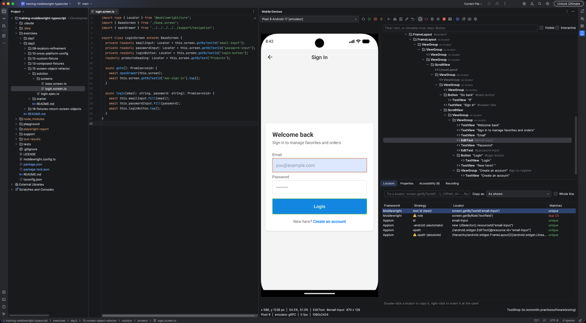
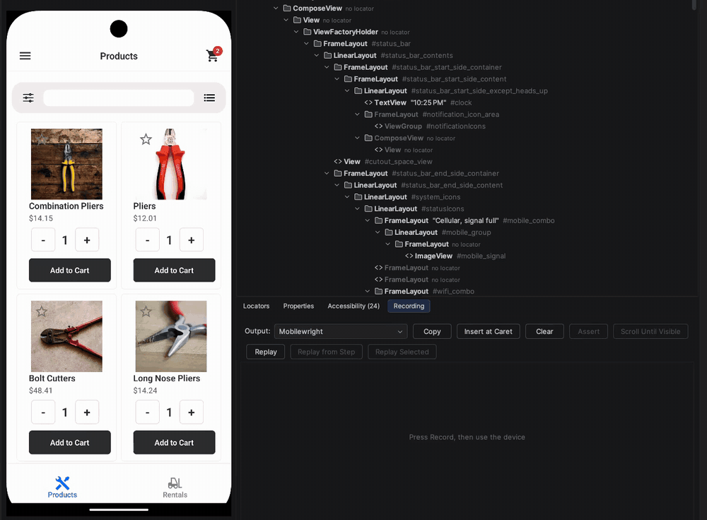

# Mobile Test Bench

Mirror and control Android and iOS devices inside your JetBrains IDE, inspect their UI, and get ready-to-paste locators for **Mobilewright**, **Appium** and **WebdriverIO**.



## What you can do

* **Mirror and control** Android emulators, Android phones, iOS simulators and iPhones from a tool window: click to tap, drag to swipe, hold to long press, type on your keyboard.
* **Inspect** the screen: element tree, highlight on the device, and every locator for the selected element with a **unique** or **dup (n)** badge, including scoped locators for repeated items.
* **Record and replay** what you do on the device as test code, with assertions, in Mobilewright, Appium (Java, Kotlin, Python, C#) or WebdriverIO.
* **Generate page objects** from a screen.
* **Find a locator on the device** from your test code (`Ctrl+Alt+Shift+M`).
* **Device Tools** for the daily chores: logs, apps and permissions, crashes, location, dark mode and language, network, battery, biometrics, web views, files, performance, visual diff and push notifications.

Recording taps on the mirror into Mobilewright code, then replaying them on the device:



See the [feature guide](docs/FEATURES.md) for the details.

## Quick start

1. **Install the plugin.** In the IDE: Settings, Plugins, the gear icon, *Install Plugin from Disk...*, and pick `MobileTestBench-<version>.zip` (see [Development](docs/DEVELOPMENT.md) to build it). Requires an IntelliJ-based IDE 2025.3 or newer.
2. **Install the tools it drives:**

   ```bash
   npm install -g mobilecli        # iOS, the Android 17 inspector, many Device Tools tabs
   # adb: Android SDK platform-tools        (Android)
   # Xcode with simctl                      (iOS simulators, macOS only)
   ```

3. **Start a device:** boot an emulator or simulator, or plug in a phone. Physical iPhones need a one-time agent install, see [Device setup](docs/DEVICE-SETUP.md).
4. **Open the Mobile Devices tool window** (right edge), pick the device and press **Connect**.

## Supported devices

| | Screen | Input | Inspector |
|---|---|---|---|
| **Android emulator** | emulator gRPC stream (mobilecli stream or adb screenshots as fallback) | gRPC | mobilecli |
| **Android phone** | mobilecli stream (adb screenshots as fallback) | adb | mobilecli |
| **iOS simulator** | mobilecli stream (WebDriverAgent or simctl without mobilecli) | mobilecli | mobilecli |
| **iPhone** | mobilecli stream | mobilecli | mobilecli |

Checked on a Pixel 9 emulator (Android 17), an iPhone 17 Pro simulator (iOS 26.5), a Samsung Z Fold8 Ultra (Android 17, including folding and unfolding) and an iPhone 13 (iOS 27). Other devices and OS versions are expected to work but have not been tried. [Known limitations](docs/DEVELOPMENT.md#status-and-known-limitations).

## Requirements

| Tool | Needed for |
|---|---|
| **[mobilecli](https://github.com/mobile-next/mobilecli)** | iOS (simulators and iPhones), the element inspector on Android 17, and the Device Tools tabs Location, Crashes, WebView, clipboard, screen recording, Device Power and Orientation. Without it Android phones mirror at about 1 frame per second and iPhones are not listed. |
| **adb** | Android devices and emulators. Found through the adb path setting, `ANDROID_HOME`, `ANDROID_SDK_ROOT` or `PATH`. |
| **Xcode** (`xcrun simctl`) | iOS simulators, macOS only. |

The plugin only depends on `com.intellij.modules.platform`, so it runs in IntelliJ IDEA, WebStorm, PyCharm, Android Studio and the other IntelliJ-based IDEs.

## How it works

A small, IDE-independent `core` package (unit tested, no IntelliJ or gRPC imports) talks to devices through `adb`, `xcrun simctl` and `mobilecli`, and to the Android emulator over its gRPC API. A `DeviceSession` per device provides frames, input and the UI hierarchy; the `ui` package renders the tool window on top of it. Input and hierarchy bounds are mapped through one coordinate layer, so retina frames, letterboxing and rotation line up. More in [Development](docs/DEVELOPMENT.md#architecture).

## Documentation

| | |
|---|---|
| [Feature guide](docs/FEATURES.md) | Everything the plugin does, with screenshots |
| [Device setup](docs/DEVICE-SETUP.md) | Android, iOS simulators, iPhones (agent install) |
| [Reference](docs/reference/) | One page per area, with limitations and what has not been verified |
| [Development](docs/DEVELOPMENT.md) | Build, test, release, architecture, known limitations |
| [Changelog](CHANGELOG.md) | Release notes |

## Privacy

The plugin has no telemetry and sends no data off your machine. It runs `adb`, `xcrun` and `mobilecli`, connects to the local emulator gRPC port, and calls a WebDriverAgent URL only when you configure one (used without mobilecli). adb, Xcode and mobilecli are separate tools with their own behaviour.

## Support

Questions, bugs and ideas: [github.com/marcomaes/MobileTestBench/issues](https://github.com/marcomaes/MobileTestBench/issues).

## License

Apache License 2.0, see [LICENSE](LICENSE) and [NOTICE](NOTICE).
