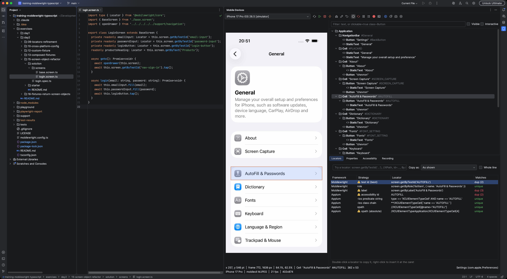
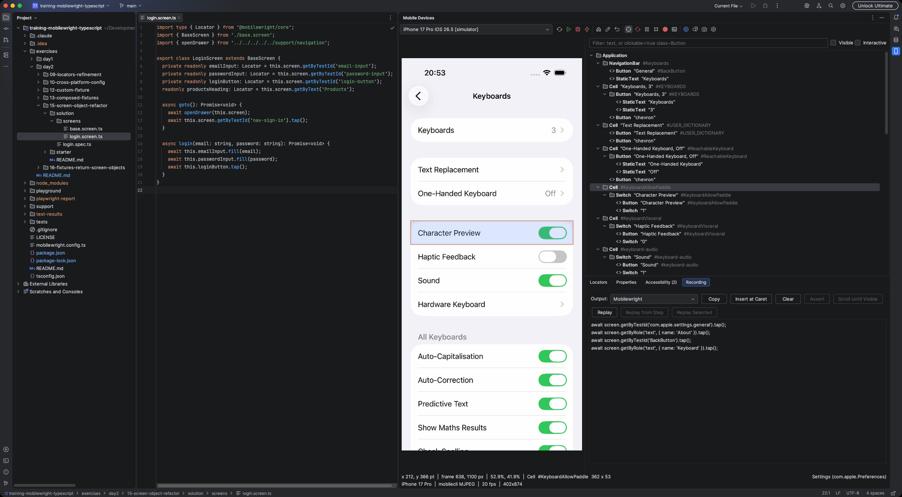
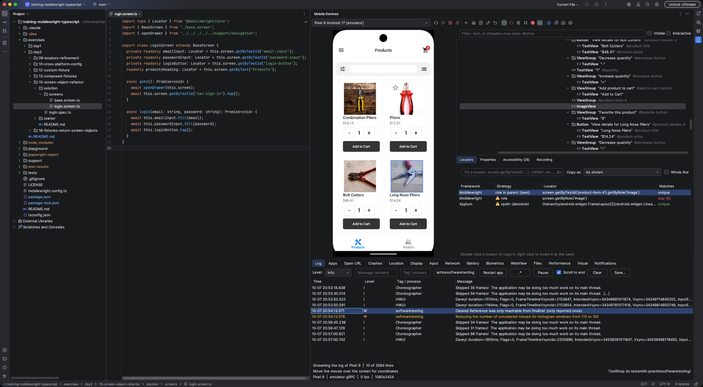
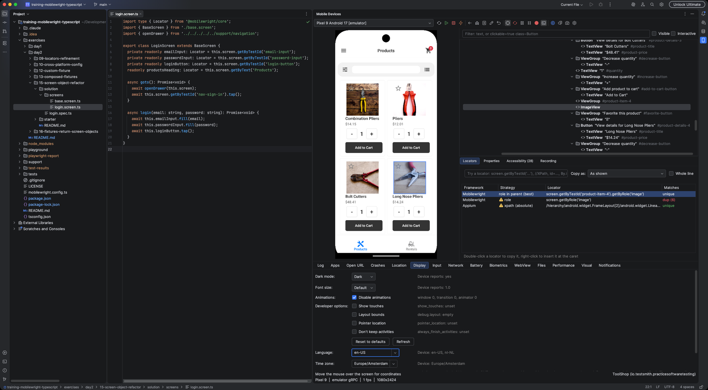

# Features

What Mobile Test Bench can do, in the order you will probably use it. Every section ends with a link to the full reference, which also lists what has not been verified. Back to the [README](../README.md).

**On this page:** [Mirror and control](#mirror-and-control) · [Inspector and locators](#inspector-and-locators) · [Recorder and replay](#recorder-and-replay) · [Page objects](#page-objects) · [Locators in the editor](#locators-in-the-editor) · [Device Tools](#device-tools) · [Device management](#device-management)

---

## Mirror and control

Open the **Mobile Devices** tool window, pick a device and press **Connect**. The screen appears in the IDE and reacts to your mouse and keyboard.

| You do | The device gets |
|---|---|
| Click | A tap |
| Drag | A swipe |
| Scroll wheel | A vertical swipe |
| Hold the mouse still for 700 ms | A long press (the time is a setting) |
| Double click | A double tap on the Android emulator, a plain tap elsewhere |
| Option/Alt + drag | Press, hold, then drag (Android emulator), a plain swipe elsewhere |
| Type | Text, Enter, Backspace, Escape (Back on Android) |

Also in the toolbar and on the screen:

* **Back, Home, Recent Apps and Type Text** buttons, **Screenshot** (to the clipboard or a PNG, optionally with the selected element outlined), and **Record Screen to Video** (MP4).
* **Freeze** stops the picture on the current frame so you can inspect a toast or a transient screen.
* **Landscape** rotates the device, and the **hover line**, **grid** and right-click **Copy** menu show device coordinates.
* The status line shows how the screen reaches the IDE (emulator gRPC, mobilecli stream or adb screenshots) and, after a fallback, why.
* Foldables switch to the active display when you fold or unfold them.

How each kind of device is driven: [Mirror and input](reference/mirror-and-input.md) · [Orientation, Freeze and coordinates](reference/device-management.md).

---

## Inspector and locators

Toggle **Inspect Elements** (the target icon) to see the element tree next to the screen. Hover the screen to highlight an element, click to select it in the tree.

* **Locators tab:** every locator for the selected element, in Mobilewright's priority order (`getByTestId`, `getByRole`, `getByLabel`, `getByText`), plus the Appium strategies (accessibility id, UiSelector, iOS predicate string, class chain, XPath).
* **unique or dup (n):** each locator shows how many elements it matches, so you can see which ones are ambiguous. A weak locator gets a warning icon with the reason.
* **Scoped locators:** when the best locator is a duplicate (every product card has the same button), the plugin suggests one scoped to its parent, such as `getByTestId('product-item-4').getByRole('image')`.
* **Copy as:** choose the output language (Mobilewright, Appium in Java, Kotlin, Python and C#, or WebdriverIO). Double-click copies, right-click can insert at the caret.
* **Try a locator:** type a Mobilewright locator, an XPath or an Appium locator, and the plugin shows the match count and highlights the matches in green on the screen.
* **Properties** shows every raw attribute, and **Accessibility** flags missing labels, small touch targets and low contrast.
* **Element filter** keeps only matching elements in the tree: text, `clickable=true`, `class~Button`, OR groups and negation.

Full reference: [Inspector and locators](reference/inspector.md).

---

## Recorder and replay

Press **Record** (the red dot) and use the device. The **Recording** tab turns what you do into test code, and every tap is tied to the best unique locator at that moment.

* Taps, typing, swipes, scrolling, Home and Back become steps. A tap that cannot be tied to a locator becomes a comment, never raw coordinates.
* **Assert** adds checks while you record, chosen from a menu that fits the element: visible, has or contains text, has value, enabled or disabled, checked, becomes hidden, count, and explicit waits.
* **Output:** Mobilewright (default), Appium in Java, Kotlin, Python or C#, or WebdriverIO. Copy it or **Insert at Caret**.
* **Replay** runs the steps again on the device, with the running step highlighted. Replay from a step, replay a selection, set a timeout per step, add a delay between steps.
* **Scroll until visible** turns recorded swipes into a loop that scrolls until the next element appears.

Full reference: [Recorder and replay](reference/recorder.md).

---

## Page objects

**Generate Page Object...** (the class icon, once the inspector has loaded a screen) lists the elements that have a unique locator and writes a page object class for them.

* Mobilewright in TypeScript or JavaScript, Appium in Java, Kotlin, Python or C#.
* Locators as fields, getters or constructor-built, with a generated base class, `tapX()` / `fillX()` / `getXValue()` methods, and optional alphabetical sorting.
* **Copy**, **Insert at Caret** or **Save...**.

Full reference: [Page objects](reference/page-objects.md).

---

## Locators in the editor

Select a locator in your test code (or put the caret on its line) and run **Show Locator on Device** from the editor menu, the Tools menu or with `Ctrl+Alt+Shift+M`. Every element it matches is highlighted in green on the mirror, and a balloon says how many matched.

Full reference: [Locators in the editor](reference/editor-integration.md).

---

## Device Tools

The console icon opens a tabbed panel below the screen.

| Tab | What it does | Devices |
|---|---|---|
| **Log** | Live device log with filters for level, text, tag and app (plain or regex). Stack trace lines open the source in the editor. Restart the app to capture its start. | Android, iOS simulator, iPhone |
| **Apps** | Installed apps with a filter, system apps hidden by default, reset app state, and a permissions dialog. | Android, iOS |
| **Open URL** | Open a link or deep link on the device, with a history. | Android, iOS |
| **Crashes** | Crash reports of the device with a summary line, copy and save. Needs mobilecli. | Android, iOS |
| **Location** | Override the GPS position, with saved places. Needs mobilecli. | Android, iOS |
| **Display** | Dark mode, font size, animations, show touches, layout bounds, language and time zone, with a reset to defaults. | Android, iOS simulator |
| **Input** | Hardware buttons, special keys, hide keyboard and the clipboard (clipboard needs mobilecli). | Android, iOS |
| **Network** | Airplane mode, Wi-Fi, mobile data, and emulator speed and latency. | Android |
| **Battery** | Simulate battery level, charging state and memory warnings. | Android |
| **Biometrics** | Simulate Face ID, Touch ID and fingerprint sensors. | iOS simulator, Android emulator |
| **WebView** | Inspect the web views of hybrid apps: DOM tree, CSS and XPath locators, JavaScript console. Debug builds only. Needs mobilecli. | Android, iOS |
| **Files** | Browse, download, upload and delete device files and app data, with previews for text, tables, SQLite, plists and SharedPreferences. | Android, iOS simulator |
| **Performance** | Memory, CPU and frame charts of one app, and app start time. | Android, iOS simulator |
| **Visual** | Save a baseline screenshot and diff the current screen against it, with ignore areas. | Android, iOS |
| **Notifications** | Send test push notifications and intents. | iOS simulator, Android |

Full reference: [Device Tools](reference/device-tools.md), one page per tab.

---

## Device management

* **Device Power:** the device list also shows stopped emulators and shut-down simulators, greyed out. **Boot**, **Shut Down** and **Reboot** them from the toolbar. Needs mobilecli.
* **Reconnect automatically:** when the connected device goes away, the plugin waits for it to come back and reconnects (default on, a setting).
* **Remembered per project:** the last device is pre-selected, and the foreground app is shown at the right end of the status line.
* **Orientation:** the Landscape toggle rotates the device. Needs mobilecli.

Full reference: [Device management and viewer tools](reference/device-management.md).

---

Missing something or found a problem? [Open an issue](https://github.com/marcomaes/MobileTestBench/issues).
